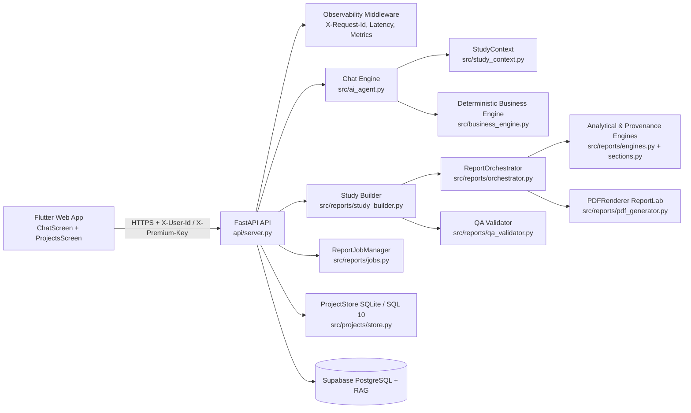

# FreeData.AI — Architecture

## System Overview

## Main Data Flows

1. **Chat & Context Persistence**: `ChatScreen` sends `message`, `history`, and `_latestStudyContext()` to `POST /api/v1/chat`. `extract_client_state()` updates `StudyContext` across all turns and returns `client_state["study_context"]`.
2. **Market Study & PDF Pipeline**: `POST /api/v1/reports/market-study[/pdf]` (or async `POST /api/v1/reports/jobs`) merges `StudyContext` into `build_market_study_dossier()`, runs `ReportOrchestrator`, executes `validate_market_study_report()`, blocks delivery (`422`) on critical QA failures, and renders institutional PDFs via `PDFRenderer`.
3. **Project & Version Management**: `ProjectStore` persists projects, `StudyContext`, conversations, messages, versioned studies (`v1`, `v2`, ...), QA results, and local PDF artifacts scoped by `owner_id`.

